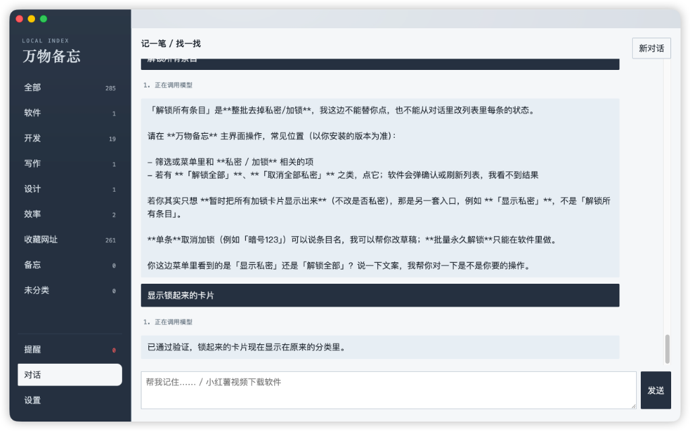

# 万物备忘

本地的个人记忆柜。把软件、项目、网址和一段话记在这台电脑上，之后用对话找回来，确认后再打开。

数据留在本机 SQLite 里。模型密钥用系统加密保存，导出时不会带走。



## 能做什么

- **对话录入。** 说「记住……」，软件先读本地路径、Git 仓库或网页，再给出确认卡。点确定后才写入。没有密钥时，仍可用本地规则做粗整理。
- **对话查找。** 直接说用途或名字，例如「小红薯视频下载软件」。列出相关条目后，由你点「打开」。
- **提醒。** 说多久之后、几点、或哪一天。时长和钟点到那一刻提醒；只说日期则提前一天。没说时间时，默认满一年的前一天提醒。到点后出现在软件里的提醒列表，并显示在程序图标上。点开一条即视为已读。
- **日历。** 在 macOS 上，提醒会写进名为「万物备忘」的日历。软件退出后，到点仍由系统日历通知。
- **私密。** 存一条时说「加锁」，这条平时不显示，也搜不到。说「解锁所有」或「显示锁起来的卡片」会弹出 Touch ID 或开机密码，通过后才显示。说「隐藏锁起来的卡片」同样要先验证。关掉窗口后自动重新隐藏。私密条目不会写入日历。
- **迁移。** 设置里可以导入 Chrome 书签，也可以把记忆导出成 zip，换机器再导入。路径里的家目录会写成占位符。

模型可选 Cursor SDK、DeepSeek、OpenAI 或智谱。

## 环境

- Node.js 20.19 或更高（本仓库用 Volta 钉在 20.20.2）
- 完整功能（日历提醒、私密验证）需要 macOS
- 打包 Windows 版时，日历和 Touch ID 不会启用

## 开发

```bash
npm install
npm run dev
```

`npm run dev` 会先编译本机的验证小工具，再启动 Electron。第一次用私密功能时，系统会询问是否允许验证身份。

常用说法：

- 「帮我记住我电脑上有个小红薯视频下载软件，名字叫 xx」
- 「小红薯视频下载软件」
- 「记住：明天下午 3 点交房租」
- 「记住银行卡密码，加锁」
- 「解锁所有」
- 「隐藏锁起来的卡片」

## 打包

```bash
npm run package:mac
npm run package:win
```

产物在 `dist/`。当前 macOS 包不做开发者签名，第一次打开时如果被系统拦住，在访达里按住 Control 再点「打开」。Windows 包建议在 Windows 或 CI 上构建。`better-sqlite3` 会在安装依赖时按 Electron 版本重建。

## 数据

数据库在 Electron 的 userData 目录，和安装包分开。设置页可以导出、导入。导出的 zip 不含模型密钥。

## 许可

[MIT](LICENSE)
